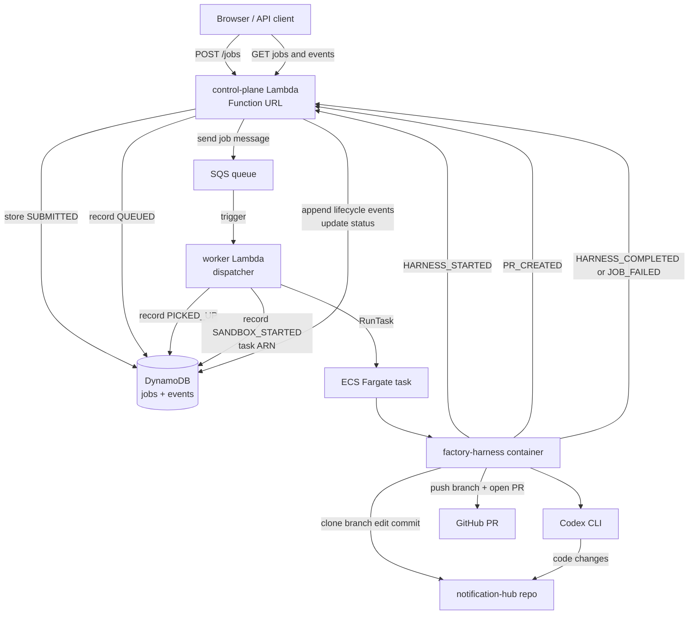

# Factory Control Plane

Serverless job control plane for software factory runs.

This repository is a standalone prototype control plane. It is separate from any target application repository. The control plane owns job intake, state, queue dispatch, lifecycle events, and basic run visibility.

It does not own agent reasoning, code-editing behavior, tool choices, or workflow instructions. Those belong later in the worker, harness, sandbox, or agent layer.

## Current Shape

The current v0 is intentionally small, but it now exercises the full factory path:

- A control-plane Lambda exposed through a Lambda Function URL
- A worker Lambda triggered by SQS
- A DynamoDB table for job records and embedded lifecycle events
- An SQS queue for dispatching jobs from the control plane to the worker
- An ECS Fargate harness task launched by the worker
- An ECR-hosted harness container image
- CloudWatch log groups with short retention
- A small static UI served by the control-plane Lambda
- Terraform-managed infrastructure

There is no API Gateway, EC2, RDS, NAT Gateway, SAM, or CDK.

## Flow



For a successful job, the lifecycle is:

```text
POST /jobs
  │
  ▼
SUBMITTED         - control plane accepted and stored the job
  │
  ▼
QUEUED            - control plane sent the job message to SQS
  │
  ▼
PICKED_UP         - worker Lambda received the SQS message
  │
  ▼
SANDBOX_STARTED   - worker Lambda started the Fargate harness task
  │
  ▼
HARNESS_STARTED   - harness container started running
  │
  ▼
PR_CREATED        - harness pushed a branch and opened a GitHub PR
  │
  ▼
HARNESS_COMPLETED - harness finished successfully
```

On failure, the harness reports `JOB_FAILED` through the same event endpoint, and the UI shows a short failure reason on the card.

The current harness uses Codex CLI inside the Fargate container to make the code change, then the harness owns the Git lifecycle: commit, push branch, open PR, and report results back to the control plane.

## API

The Lambda Function URL serves the prototype UI at `/` and exposes the control-plane API.

### Workflows

```http
GET /workflows
```

Returns the currently accepted workflow labels:

```json
{
  "workflows": [
    {
      "workflowId": "feature-development",
      "name": "Feature development"
    },
    {
      "workflowId": "incident-investigation",
      "name": "Incident investigation"
    }
  ]
}
```

These workflow IDs are routing/category labels only. They do not specify tools, prompts, shell behavior, Git behavior, or test behavior.

### Create Job

```http
POST /jobs
```

Example request:

```json
{
  "workflowId": "feature-development",
  "title": "Add registration validation",
  "description": "Validate phone number during customer registration"
}
```

The control plane validates the request, writes a DynamoDB job record, sends a message to SQS, and records lifecycle events.

### List Jobs

```http
GET /jobs
```

Returns job summaries and counts for the UI board. Job summaries include derived PR links and short failure reasons when available.

### Get Job

```http
GET /jobs/{jobId}
```

Returns the full job record.

### Get Job Events

```http
GET /jobs/{jobId}/events
```

Returns the lifecycle event timeline for a job.

### Append Job Event

```http
POST /jobs/{jobId}/events
```

Used by the harness container to report lifecycle events back to the control plane.

Example:

```json
{
  "type": "HARNESS_COMPLETED",
  "message": "Harness completed successfully.",
  "details": {
    "commitSha": "abc123"
  }
}
```

`HARNESS_COMPLETED` moves the job to the finished/succeeded lane. `JOB_FAILED` moves it to the finished/failed lane.

## Repository Layout

```text
infra/
  main.tf
  outputs.tf
  variables.tf
  versions.tf

src/
  control_plane/
    handler.py
  worker/
    handler.py

ui/
  index.html
  styles.css
  app.js
```

## Deploy

From the repository root:

```sh
terraform -chdir=infra init
terraform -chdir=infra plan
terraform -chdir=infra apply
```

Terraform packages the Lambda code and static UI into zip files locally, then updates AWS.

## Smoke Tests

Set the Function URL after deploy:

```sh
BASE_URL="https://your-function-url.lambda-url.us-east-1.on.aws"
```

Health:

```sh
curl "$BASE_URL/health"
```

Workflows:

```sh
curl "$BASE_URL/workflows"
```

Create a job:

```sh
curl -X POST "$BASE_URL/jobs" \
  -H 'content-type: application/json' \
  -d '{
    "workflowId": "feature-development",
    "title": "Queue smoke test",
    "description": "Confirm control plane stores and dispatches a job"
  }'
```

List jobs:

```sh
curl "$BASE_URL/jobs"
```

Open the UI:

```text
https://your-function-url.lambda-url.us-east-1.on.aws/
```

## Local Checks

Python syntax:

```sh
python3 -m py_compile src/control_plane/handler.py src/worker/handler.py
```

JavaScript syntax:

```sh
node --check ui/app.js
```

Terraform formatting:

```sh
terraform fmt -recursive
```

## Notes

- DynamoDB is the source of truth for job state and event history.
- SQS is the dispatch buffer between the control plane and worker.
- The UI is currently served by the control-plane Lambda for prototype simplicity.
- Longer term, the UI can move to S3/CloudFront and the control plane can remain API-only.
- Terraform state files and generated zip files should not be committed.
