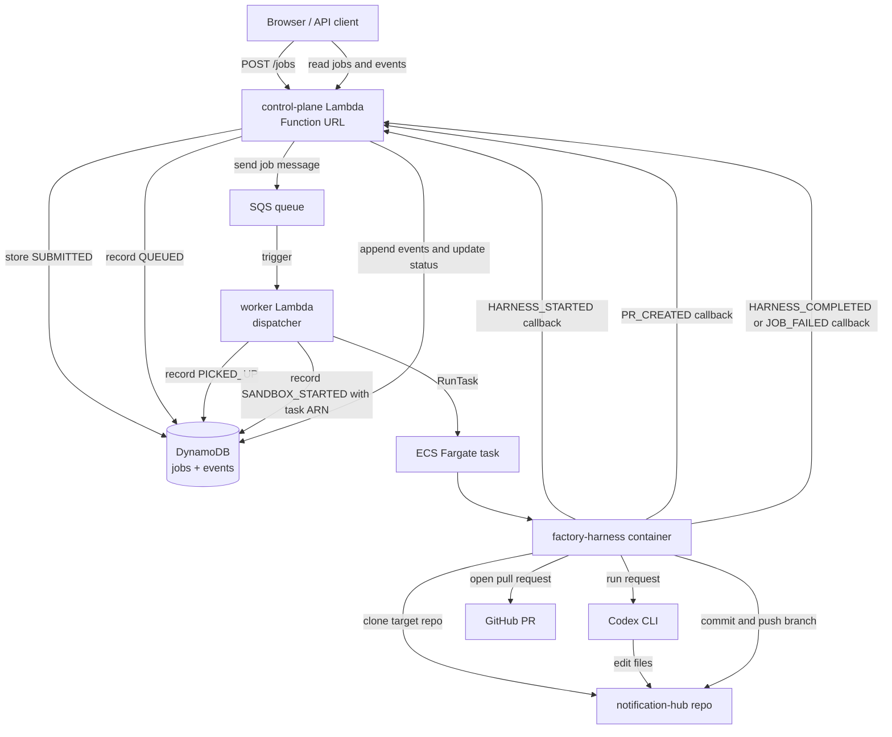

# Factory Architecture

This prototype is split into three boundaries:

```text
factory-control-plane
  Owns job intake, state, dispatch, lifecycle events, UI/API visibility, and AWS orchestration.

factory-harness
  Runs inside the sandbox. Owns target repo checkout, Codex execution, commit, push, PR creation, and result callbacks.

target repository
  The application codebase being changed. Today this is abhiverma31/notification-hub.
```

The control plane does not hardcode agent reasoning or repo-specific skills. It launches a generic harness and records lifecycle signals.

## End-to-End Flow



## Component Responsibilities

### Control-Plane Lambda

The control-plane Lambda serves both the prototype UI and the JSON API.

It owns:

```text
GET /workflows
POST /jobs
GET /jobs
GET /jobs/{jobId}
GET /jobs/{jobId}/events
POST /jobs/{jobId}/events
```

It validates job intake, writes job records, appends lifecycle events, and exposes job state for the UI.

### DynamoDB

DynamoDB is the job ledger.

It stores:

```text
job metadata
current status
embedded lifecycle events
harness task ARN
derived PR details through event history
```

### SQS

SQS is the dispatch buffer between job intake and sandbox launch.

The queue message carries the job fields needed by the dispatcher:

```text
jobId
workflowId
title
description
```

### Worker Lambda

The worker Lambda is currently acting as the dispatcher.

It owns:

```text
JOB_PICKED_UP
SANDBOX_STARTED
ECS RunTask
passing job context into the harness container
```

It does not perform the feature work itself.

### ECS Fargate

Fargate provides the short-lived sandbox where the harness runs.

The task receives non-secret job context through container environment variables:

```text
JOB_ID
WORKFLOW_ID
TITLE
DESCRIPTION
CONTROL_PLANE_URL
CHANGE_MODE
```

It receives secrets through ECS task-definition secrets:

```text
GITHUB_TOKEN
OPENAI_API_KEY
```

### Factory Harness

The harness owns the repo and PR lifecycle inside the sandbox:

```text
clone target repo
create job branch
run Codex
commit changes
push branch
open pull request
report lifecycle events back to control plane
```

The harness reports through:

```text
POST /jobs/{jobId}/events
```

### Codex

Codex is invoked by the harness inside the cloned target repository.

The harness prompt passes:

```text
workflow ID
title
description
```

Codex edits files only. The harness remains responsible for commit, push, and PR creation.

### GitHub

GitHub receives the pushed factory branch and pull request.

The control-plane UI derives the PR link from the `PR_CREATED` lifecycle event and shows it on the run card.

## Lifecycle

Successful run:

```text
SUBMITTED
QUEUED
PICKED_UP
SANDBOX_STARTED
HARNESS_STARTED
PR_CREATED
HARNESS_COMPLETED
```

Failure run:

```text
SUBMITTED
QUEUED
PICKED_UP
SANDBOX_STARTED
HARNESS_STARTED
JOB_FAILED
```

Status mapping:

```text
QUEUED              -> queued lane
PICKED_UP           -> running lane
HARNESS_COMPLETED   -> finished / succeeded
FAILED              -> finished / failed
```

## Secrets

Secrets are stored outside Terraform state in SSM Parameter Store as SecureString parameters.

Terraform stores only parameter ARNs:

```text
GitHub token parameter ARN
OpenAI API key parameter ARN
```

ECS injects those into the harness container at runtime.

## Current v0 Limitations

```text
Lambda Function URL uses AuthType NONE.
The event callback endpoint has no shared-token auth yet.
Workflow registry is static.
The worker is named worker even though it behaves as a dispatcher.
No dead-letter queue is configured yet.
No retry/cancel/approval model yet.
Harness behavior is generic and repo-agnostic.
Repo-specific skills/instructions are not introduced yet.
```
